# VELVET & CONE

## Design Documentation

**A warm, editorial design system for an artisanal small-batch gelato atelier.**

**PUBLIC WEBSITE · ADMIN PORTAL · 19 SCREENS**

| Alabaster | Cream | Espresso | Cocoa | Gold | Gold Light | Taupe |
|---|---|---|---|---|---|---|
| `#FAF6F0` | `#F3ECE1` | `#1E1611` | `#382920` | `#C69C6D` | `#DFC097` | `#8C7A6B` |

**Prepared November 2026** · Version 1.0 · Front-end prototype

---

## Contents

**01** &nbsp; [Overview](#01-overview)  
**02** &nbsp; [About the Business](#02-about-the-business)  
**03** &nbsp; [Design Process](#03-design-process)  
**04** &nbsp; [Typography](#04-typography)  
**05** &nbsp; [Color Scheme](#05-color-scheme)  
**06** &nbsp; [Screens](#06-screens)

&nbsp;&nbsp;&nbsp;&nbsp;Public Website · Admin Portal

| SCREENS | TYPEFACES | PALETTE |
|---|---|---|
| **19** — public and admin screens captured from the prototype | **2** — Cormorant Garamond and Plus Jakarta Sans | **7 + supports** — core color tokens and dark fixed tints |

> **DOCUMENT NOTE** Headings and body copy are set in Cormorant Garamond and Plus Jakarta Sans, loaded from Google Fonts in `index.html`. Locally installed fallbacks (Georgia and system UI) are substituted if the brand fonts are unavailable.

---

## 01 Overview

Velvet & Cone is an artisanal gelato and ice-cream atelier built around dense, slow-churned texture and carefully sourced ingredients. The brand presents gelato as a small-batch craft rather than a quick treat: heritage cream, single-origin cacao, stone-milled pistachios and copper-barrel batch freezing, drawn at −14°C and served within 48 hours.

The website translates that character into a digital experience. The public site introduces the creamery, narrates the making process through a scroll-linked 3D hero, presents the seasonal flavor archive with tasting notes, explains how to reserve a pickup flight at one of three ateliers, and lets guests build a small pickup bag. A separate, PIN-gated admin portal gives the team a practical view of availability, orders and hero media.

This document records the visual language and the screens that make up the front-end prototype. It is intended as a reference for design, content and implementation decisions rather than a technical specification.

| PUBLIC WEBSITE | ADMIN PORTAL | PROTOTYPE |
|---|---|---|
| **4 routes** — Home, Our Craft, Seasonal Flavors and Ateliers & Pickup. A warm introduction to the product, the process and the counter. | **4 views behind one login** — Overview, Flavor Manager, Order Fulfillment and Hero Media. Operational density in the same palette. | **Front-end only** — React 19, TypeScript, Vite 8 and Tailwind v4, with a local `localStorage` data layer; no backend or payment processing. |

> **SOURCE MATERIAL** [`Design_Tokens/DESIGN.md`](Design_Tokens/DESIGN.md) and the 19 screenshots in [`Screenshots/`](Screenshots/) supplied with this prototype.

---

## 02 About the Business

Velvet & Cone is a small independent creamery with a simple belief: texture is the product. Each batch begins before dawn with micro-dairy heritage Jersey cream, whole Madagascar vanilla pods steeped for thirty-six hours, and Criollo cacao roasted and milled in-house. Pistachios from Bronte are stone-ground for their emerald oils; waffle cones are pressed to order on cast-iron plates. Vertical copper batch freezers turn slowly at 60 RPM, holding overrun to 18–22% so the finished gelato stays dense and silk-like instead of airy.

The range moves between signatures — 72% Criollo Midnight Cacao, Madagascar Bourbon Vanilla Bean, Salted Brown Butter & Pecan — and seasonal experiments such as Bronte Pistachio & Saffron, Uji Ceremonial Matcha Oat and Black Sesame & Roasted Fig. Guests can browse tasting notes and dietary tags, add scoops to a pickup bag, or reserve a two-scoop tasting flight at the Flagship Atelier in SoHo, the Conservatory Roastery in Venice, or the Harbour Pavilion in Boston.

The website is designed to feel like an extension of the counter: generous serif headlines, warm paper surfaces, antique-gold details and photography that leaves room for the product to breathe. Every public screen is designed to inform without rushing the visitor, while the admin screens give the team the practical tools to run the day — publish a seasonal flavor, change an availability status, advance an order through churning, or swap the homepage hero canvas.

---

## 03 Design Process

1. **Research** — Study artisanal gelato brands, packaging and editorial food publishing; define the sensory cues (copper, cream, parchment, cold steel) and the three production stories that anchor the homepage scroll.
2. **Ideate** — Map the two audiences — guests browsing the counter and staff running it — into four public routes and a single PIN-gated operations portal with four views; sketch the scroll narrative and the shared card/chip vocabulary.
3. **UI Designing** — Establish the two-family type system, the seven-token warm palette and the dark espresso surfaces; design the 3D hero frame, flavor cards, tasting modal, pickup drawer, kanban order board and media controls at desktop width, then collapse the layouts for small screens.
4. **Implementation** — Build the system as Tailwind v4 `@theme` tokens in `src/index.css`; implement the React components, the mock store in `src/context/StoreContext.tsx`, the scroll-linked canvas with a lazy-loaded GLB model, and the reduced-motion fallbacks; verify with `npm run lint` and `npm run build`.

---

## 04 Typography

Two families carry the system. Cormorant Garamond gives the brand its editorial, hospitality-led voice; Plus Jakarta Sans keeps menus, labels, forms and admin controls clear and direct. The contrast is deliberate: expressive headlines, functional details. A monospace stack is used only for numeric metadata.

### Type specimen

| Cormorant Garamond | Plus Jakarta Sans |
|---|---|
| **Aa** — Display · Headlines | **Aa** — Body · Labels · UI |

### Type scale

| ROLE | FAMILY | SIZE | WEIGHT | LINE HEIGHT | USE |
|---|---|---|---|---|---|
| Display XL | Cormorant Garamond | 96 px (`text-8xl`) | 500 | 86 px (`leading-[0.9]`) | Desktop hero headline |
| Display LG | Cormorant Garamond | 72 px (`text-7xl`) | 500 | 65 px | Tablet hero and Craft `h1` |
| Display MD | Cormorant Garamond | 60 px (`text-6xl`) | 500 | 60 px | Flavors and Locations `h1`, featured churn heading |
| Headline LG | Cormorant Garamond | 48 px (`text-5xl`) | 500 | 48 px | Mobile hero, base page `h1` |
| Headline MD | Cormorant Garamond | 36 px (`text-4xl`) | 500 | 38 px | Section titles, admin metrics |
| Headline SM | Cormorant Garamond | 30 px (`text-3xl`) | 500 | 36 px | Admin panel titles |
| Title | Cormorant Garamond | 24 px (`text-2xl`) | 500–600 | 30 px | Flavor and location card titles, modal title |
| Body LG | Plus Jakarta Sans | 18 px | 400 | 29 px | Intro and editorial copy |
| Body MD | Plus Jakarta Sans | 16 px | 400 | 26 px | Descriptions, form fields |
| Body SM | Plus Jakarta Sans | 14 px | 400 | 22 px | Card copy, metadata, table cells |
| Label MD | Plus Jakarta Sans | 12 px | 600 | 18 px | Navigation, buttons, labels, chips |
| Label SM | Plus Jakarta Sans | 10–11 px | 600 | 14 px | Eyebrows, micro-labels, progress caption |
| Mono meta | ui-monospace | 10–12 px | 400 | 14 px | Order IDs, chapter numbers, scroll progress |

### Typesetting rules

- Every `h1`–`h4` is serif; display headlines use tight tracking (`tracking-tight`) with near-solid line height for the hero.
- Eyebrows and section labels are uppercase with wide tracking: `0.22–0.24em` on page eyebrows, `0.18em` on navigation, `0.14–0.16em` on chips and buttons.
- Body copy stays at 14–18 px with relaxed 22–29 px line height; longer editorial passages use `leading-relaxed`.
- Prices, metrics and numbers within cards are set in the serif to keep them feeling considered rather than transactional; only IDs and the progress indicator use mono.
- The system uses no more than two families; weight, scale and case create hierarchy.

---

## 05 Color Scheme

The palette follows the scoop: warm paper and cream as the canvas, espresso and cocoa for structure and depth, antique gold for highlights and action. Cream is the default; espresso carries type and dark immersive surfaces; gold is reserved for accents and active states.

| Alabaster | Cream | Espresso | Cocoa | Gold | Gold Light | Taupe |
|---|---|---|---|---|---|---|
| `#FAF6F0` | `#F3ECE1` | `#1E1611` | `#382920` | `#C69C6D` | `#DFC097` | `#8C7A6B` |

### Core tokens

| TOKEN | HEX | USE |
|---|---|---|
| `alabaster` | `#FAF6F0` | Default page canvas and light text on dark surfaces |
| `cream` | `#F3ECE1` | Alternate sections, card wells, inactive chips |
| `espresso` | `#1E1611` | Primary ink, dark navigation/footer, admin sidebar, primary buttons |
| `cocoa` | `#382920` | Button hover, featured card base, dark image scrims |
| `gold` | `#C69C6D` | Eyebrows, icons, focus borders, active navigation, primary accent button |
| `gold-light` | `#DFC097` | Light accent on dark surfaces and hover state on gold |
| `taupe` | `#8C7A6B` | Metadata, captions and supporting labels (use with care, see contrast) |

Fixed tints extend the dark theme: featured churn panels `#211711`, hero loading layer `#17100c`, hero gradient stops `#130d09 / #21150f / #120c09`, and the three procedural glows `rgba(137,79,45,0.34)` (criollo), `rgba(198,156,109,0.3)` (vanilla) and `rgba(105,127,81,0.3)` (pistachio). Flavor swatches in the data layer are their own per-product colors. Emerald, amber and rose are reserved for stock, warning and destructive feedback.

### Using the palette

- Use Alabaster (`#FAF6F0`) as the default canvas, with Cream (`#F3ECE1`) for nested surfaces and inactive selections — never pure white as the page background.
- Use Espresso (`#1E1611`) for primary type, the fixed header on scroll, the footer and the admin sidebar. Keep Cocoa (`#382920`) for hover and layered dark panels.
- Use Gold (`#C69C6D`) for focus borders, scroll progress, active navigation and small highlights; use Gold Light (`#DFC097`) when the accent sits on espresso.
- Taupe is a quiet metadata color, not a body-text color — prefer `cocoa/75` (`#695C54` composited) for longer secondary copy.
- The prototype uses one light theme. Dark espresso surfaces create contrast within that theme rather than a separate dark mode.

### Contrast

| PAIR | RATIO | RESULT | INTENDED USE |
|---|---|---|---|
| `#1E1611` on `#FAF6F0` | 16.56:1 | AAA | Primary text on the page canvas |
| `#382920` at 80% on `#FAF6F0` → `#5F524A` | 6.99:1 | AA | Supporting copy (`text-cocoa/80`) |
| `#8C7A6B` on `#FAF6F0` | 3.82:1 | AA Large only | Metadata and labels — below AA for normal text |
| `#FAF6F0` on `#1E1611` | 16.56:1 | AAA | Light text on espresso panels and footer |
| `#FAF6F0` on `#382920` | 12.95:1 | AAA | Light text on cocoa cards and scrims |
| `#1E1611` on `#C69C6D` | 7.11:1 | AAA | Text on gold buttons |
| `#1E1611` on `#DFC097` | 10.29:1 | AAA | Espresso text on light gold hover |
| `#DFC097` on `#1E1611` | 10.29:1 | AAA | Gold-light eyebrows on dark hero and sidebar |
| `#FAF6F0` at 65% on `#1E1611` → `#ADA8A2` | 7.55:1 | AAA | Muted hero body copy (`text-alabaster/65`) |
| `#FAF6F0` on `#C69C6D` | 2.33:1 | Decorative | Not suitable for body text on gold |

Ratios are calculated from token hex values and rounded to two decimals; alpha pairs are first composited over their background. AA requires 4.5:1 for normal text, AAA requires 7:1. Taupe on alabaster is the one token pairing that falls short for normal-size text; it is used only for short metadata and should be darkened if it is ever used for sustained copy.

---

## 06 Screens

The prototype has four public routes and one admin route containing four tabbed views. Public screens are designed for browsing and atmosphere; the admin portal is designed for operational clarity. The screenshots below are captured at desktop width, with the scroll-linked hero shown at two scroll positions. Flavor names, prices, orders and pickup slots are sample prototype content.

### Screen inventory

| ROUTE | SCREEN | CONTENTS |
|---|---|---|
| `/` | Home | 3D scroll hero, creamery philosophy and pillars, featured churns, flavor cards |
| `/craft` | Our Craft | Three chapters — heritage cream, cacao and copper churn — with atelier specifications |
| `/flavors` | Seasonal Flavors | Search, four filters, six flavor cards, tasting modal and pickup-bag drawer |
| `/locations` | Ateliers & Pickup | Three atelier cards, pickup reservation form and confirmation receipt |
| `/admin` | Operations Portal | PIN login plus Overview, Flavor Manager, Order Fulfillment and Hero Media tabs |

## Public Website

### HOMEPAGE — HERO & 3D SCOOP

A sticky espresso canvas fills the first viewport. A lazily loaded GLB cone rotates under warm key and fill lights while a radial glow, dotted grain and left-to-right gradient frame the editorial headline and the "scroll to discover" cue.

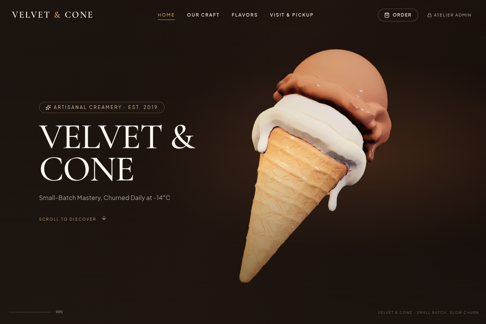
*Figure 01 — Homepage — Hero & 3D Scoop. Captured at desktop width (1290 × 862).*

### HOMEPAGE — SCROLL-LINKED CALLOT

Scroll progress eases through four milestones — Raw Alchemy, Copper Churning, Hand-Rolled Waffle and The Final Pour. Each callout fades and lifts inside a frosted espresso card; a gold progress bar and percentage readout anchor the lower-left corner.

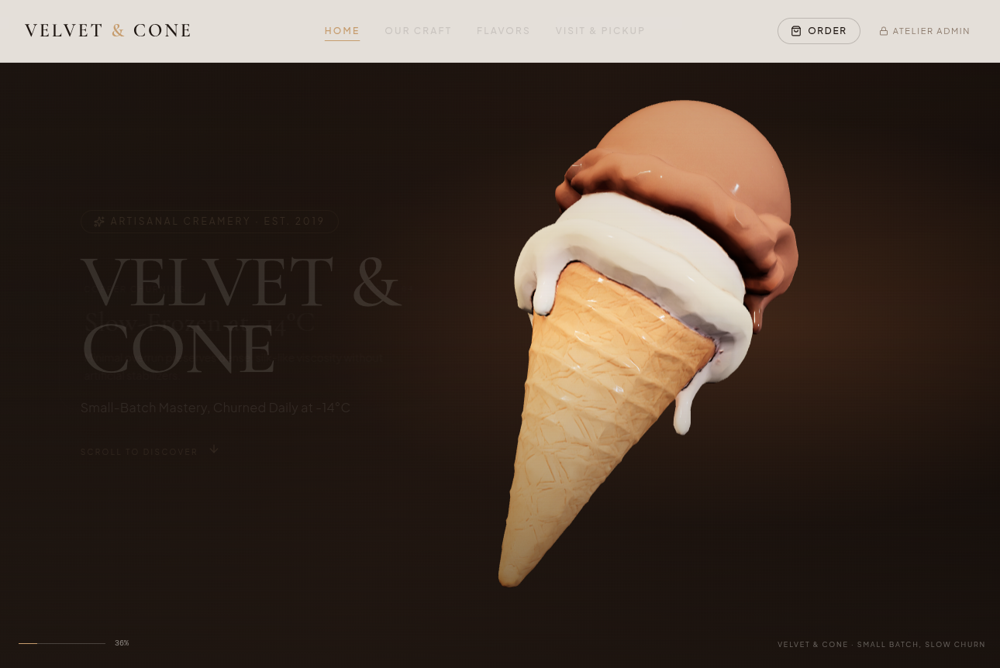
*Figure 02 — Homepage — Scroll-Linked Callout. Captured at desktop width (1290 × 862).*

### HOMEPAGE — CREAMERY PHILOSOPHY

The first light section pairs a serif statement with a short production note, followed by three pillared cards for overrun density, single-origin harvests and organic meadow dairy. Cards use cream wells and gold icons with a border that warms on hover.

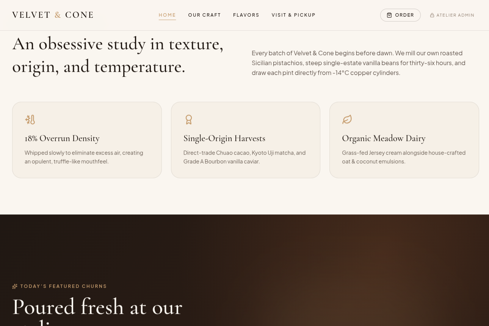
*Figure 03 — Homepage — Creamery Philosophy. Captured at desktop width (1290 × 862).*

### HOMEPAGE — TODAY'S FEATURED CHURNS

A dark gradient band introduces the featured batch with a masked sundae image and a link to the full flavor archive. The mask and radial gold blur make the product feel lit from within the espresso surface.

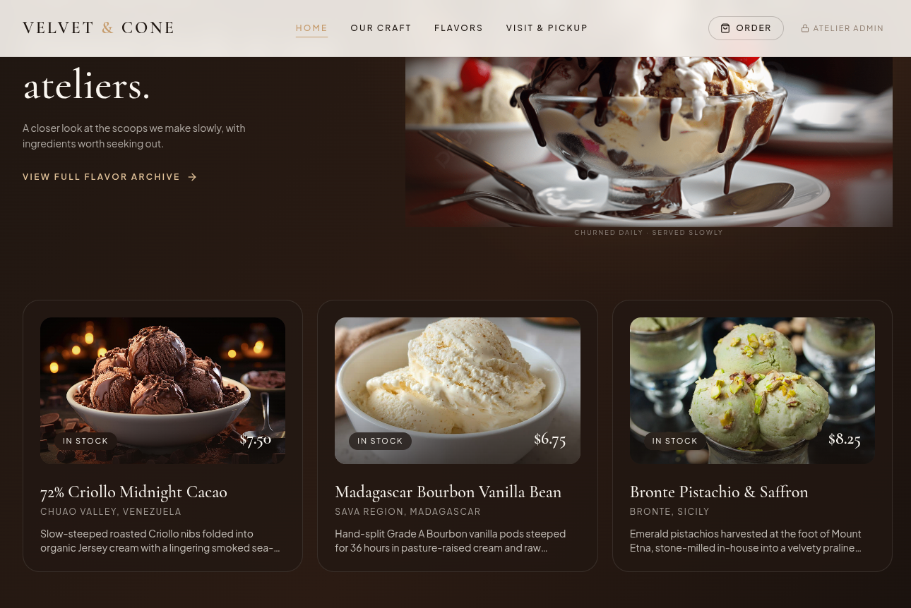
*Figure 04 — Homepage — Today's Featured Churns. Captured at desktop width (1290 × 862).*

### HOMEPAGE — FEATURED FLAVOR CARDS

Three featured flavors sit in dark cards with photographic swatch panels, availability pills, price and origin. Selecting a card opens the tasting modal; the cards lift and warm their border on hover.

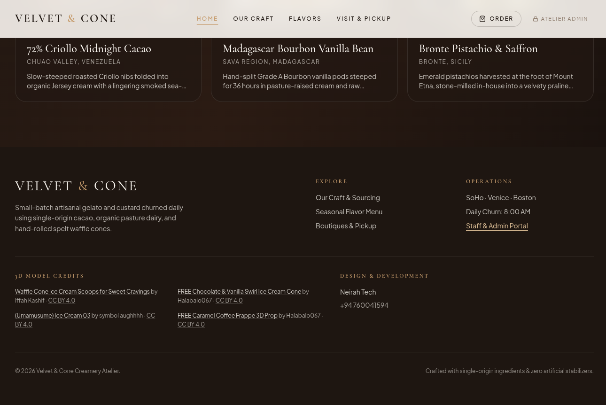
*Figure 05 — Homepage — Featured Flavor Cards. Captured at desktop width (1290 × 862).*

### CRAFT — EDITORIAL HERO

The Craft page opens with a wide serif statement — "Patience is our primary ingredient" — and a short explanation of the three-day process. The restrained light canvas gives the production story room before the interactive chapters begin.

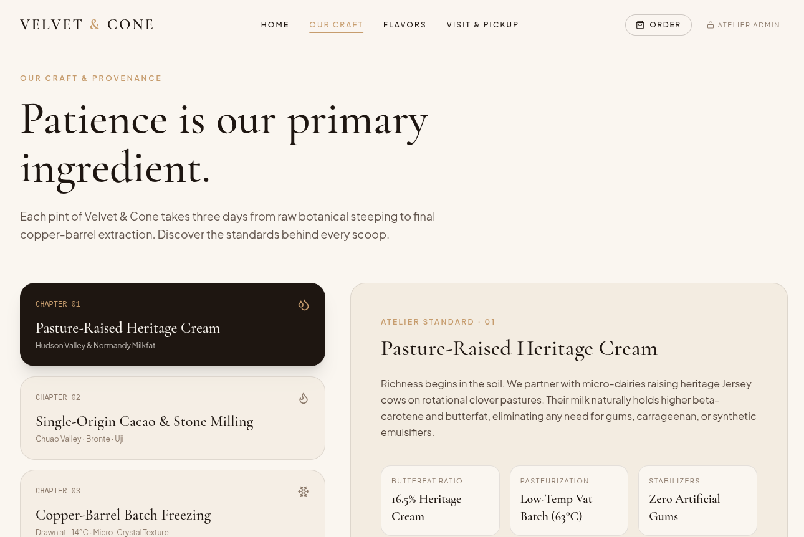
*Figure 06 — Craft — Editorial Hero. Captured at desktop width (1290 × 862).*

### CRAFT — ATELIER STANDARDS

Three numbered chapter selectors sit against a cream detail panel. The active chapter flips to espresso with a gold index and icon, while specification tiles show butterfat, infusion time, overrun and draw temperature in a three-column grid.

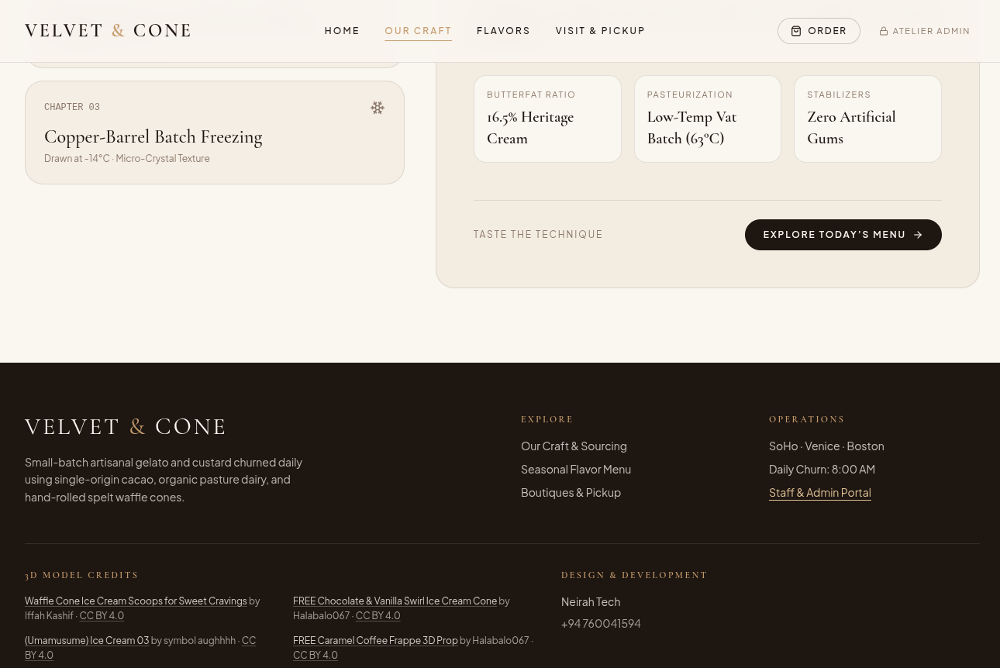
*Figure 07 — Craft — Atelier Standards. Captured at desktop width (1290 × 862).*

### FLAVORS — ARCHIVE HEADER & FILTERS

The seasonal archive pairs a gold eyebrow and large serif title with a pill search field. Four filter pills — All, Seasonal, Vegan and Nut-Free — use the shared active/inactive pattern; the active filter fills with espresso.

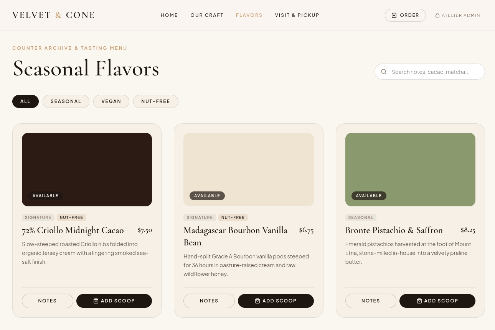
*Figure 08 — Flavors — Archive Header & Filters. Captured at desktop width (1290 × 862).*

### FLAVORS — FLAVOR GRID

Cards arrange in three columns with per-flavor swatch panels, category and dietary chips, tasting descriptions, a Notes action and an Add Scoop action. Sold-out flavors switch the action to a disabled state and use a rose availability pill.

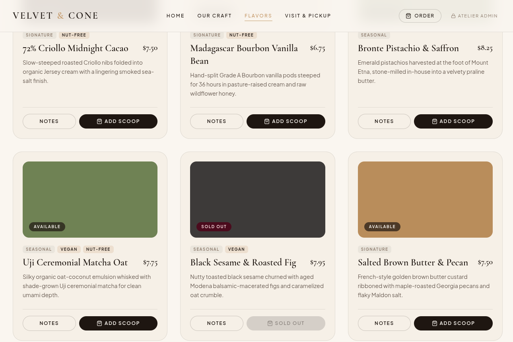
*Figure 09 — Flavors — Flavor Grid. Captured at desktop width (1290 × 862).*

### FLAVORS — TASTING NOTES MODAL

Opening a flavor reveals a centered frosted overlay: swatch header, tasting-note chips, provenance and calorie/diet detail, availability and a primary Add to Pickup Order button. The modal keeps the same 24px corner language as the cards beneath it.

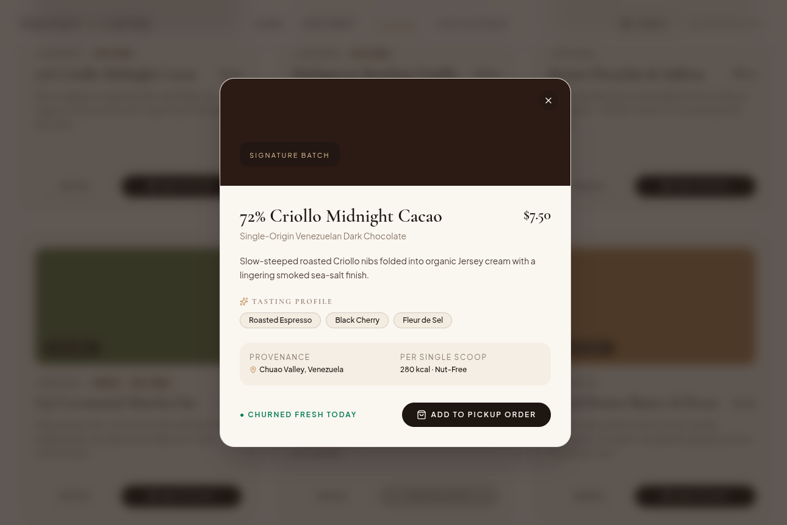
*Figure 10 — Flavors — Tasting Notes Modal. Captured at desktop width (1290 × 862).*

### FLAVORS — PICKUP BAG DRAWER

Adding a scoop slides in a right-hand drawer. Items show swatch, unit price and stepper controls; the checkout form collects a guest name, boutique and pickup slot before creating a local order. The espresso scrim and blur keep focus on the bag.

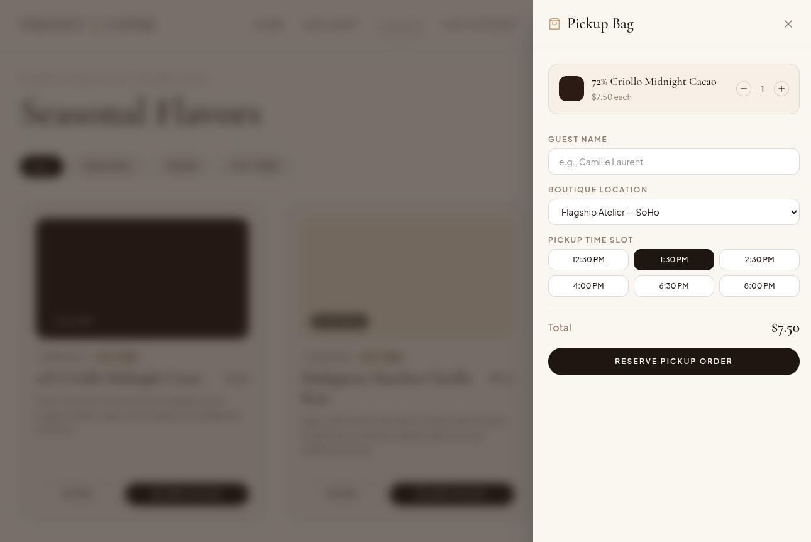
*Figure 11 — Flavors — Pickup Bag Drawer. Captured at desktop width (1290 × 862).*

### LOCATIONS — ATELIER DIRECTORY

Three atelier cards list address, hours, phone and specialty. The selected location flips to espresso with gold icons, and its details drive the reservation panel on the right.

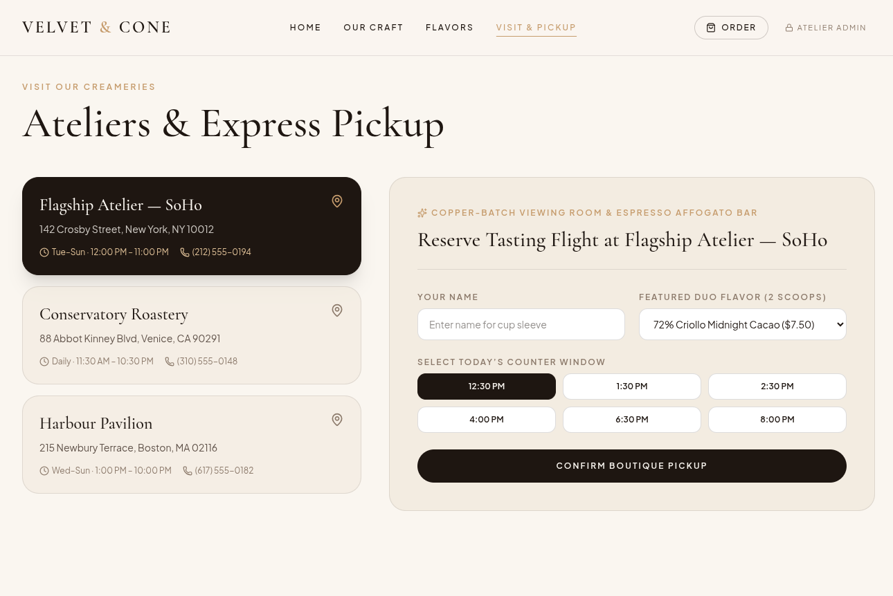
*Figure 12 — Locations — Atelier Directory. Captured at desktop width (1290 × 862).*

### LOCATIONS — PICKUP RESERVATION

The reservation panel collects a name for the cup sleeve, a featured two-scoop flavor and one of the location's counter windows. Time slots are selectable cream tiles that turn espresso when active.

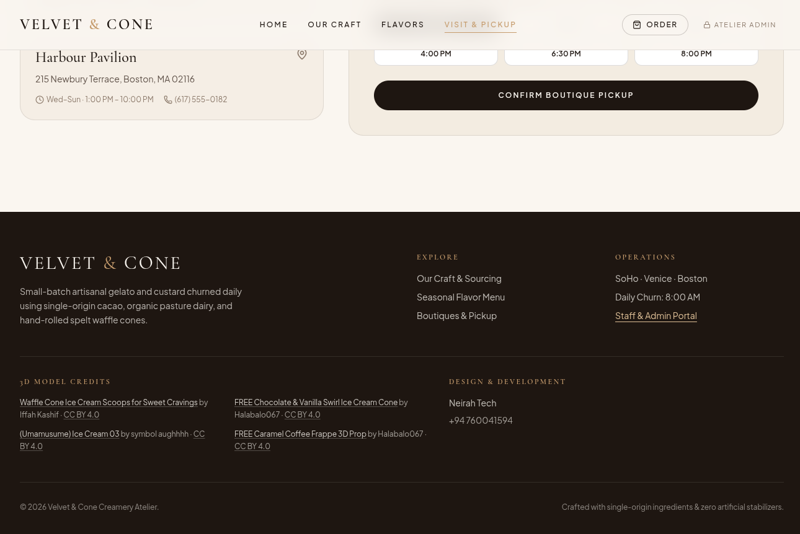
*Figure 13 — Locations — Pickup Reservation. Captured at desktop width (1290 × 862).*

### LOCATIONS — CONFIRMATION STATE

Submitting the form replaces it with an emerald confirmation card containing the generated `VC-` order ID, guest name and pickup window, and points the guest to the admin fulfillment board.

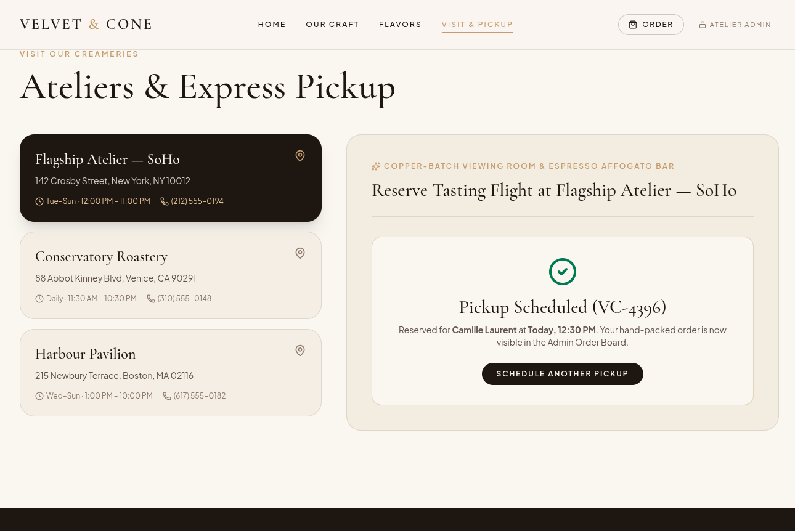
*Figure 14 — Locations — Confirmation State. Captured at desktop width (1290 × 862).*

### PUBLIC SITE NOTES

- The same fixed header, footer and four-link navigation carry across all public routes; the header is transparent over the home hero and becomes a blurred alabaster bar after 40px of scroll.
- Flavor cards, filter chips, pickup slots and admin status pills all use the same pill-shaped visual grammar, so the storefront and the portal read as one system.
- Prices, flavors and operating hours are labelled as sample prototype content; no payment is taken and no order leaves the browser.
- All state — flavors, orders, hero copy and selection — is persisted in `localStorage` in the current browser; the admin session itself lives in `sessionStorage`.

## Admin Portal

### ADMIN — ATELIER PIN LOGIN

The portal is gated by a centered espresso card with a password field, an "Unlock Operations Portal" pill and a demo-access link. The Staff Only chip and gold lock tile establish the operational tone before any data is shown.

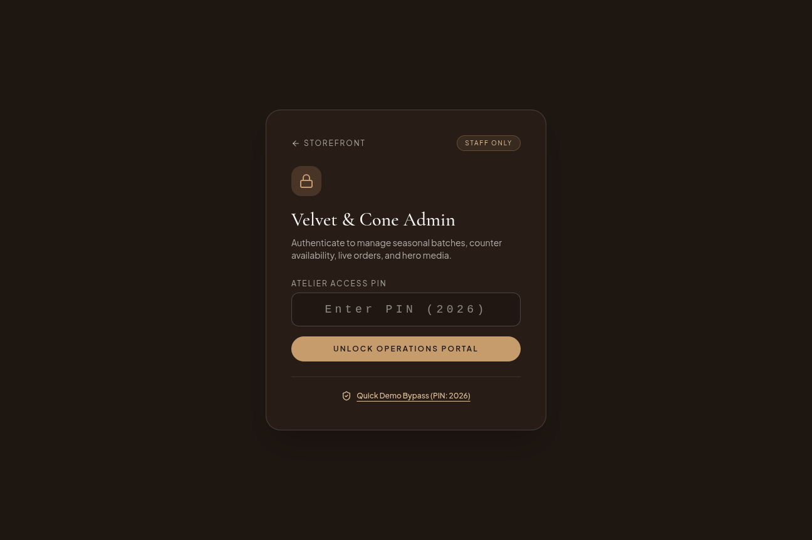
*Figure 15 — Admin — Atelier PIN Login. Captured at desktop width (1296 × 862).*

### ADMIN — OPERATIONS OVERVIEW

A fixed espresso sidebar holds the four views and session actions. The overview computes four KPIs — total orders, active flavors, inventory alerts and daily revenue — followed by the latest incoming orders. White cards and hairline dividers switch the system into a denser, tabular register.

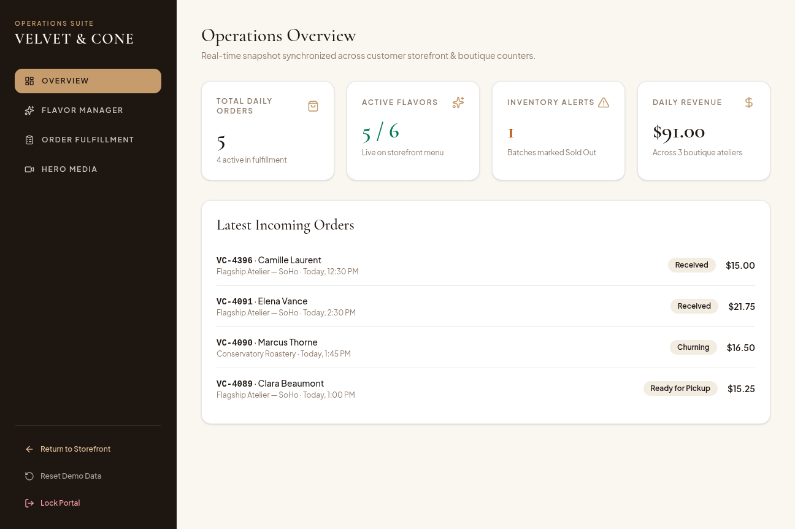
*Figure 16 — Admin — Operations Overview. Captured at desktop width (1296 × 862).*

### ADMIN — FLAVOR & BATCH MANAGER

The flavor table shows swatch, name, origin, category and dietary tags, an inline price editor, a stock pill and a remove action. The "Add Seasonal Flavor" form expands above the table with tasting notes, a color picker and dietary checkboxes; changes immediately update the customer-facing menu.

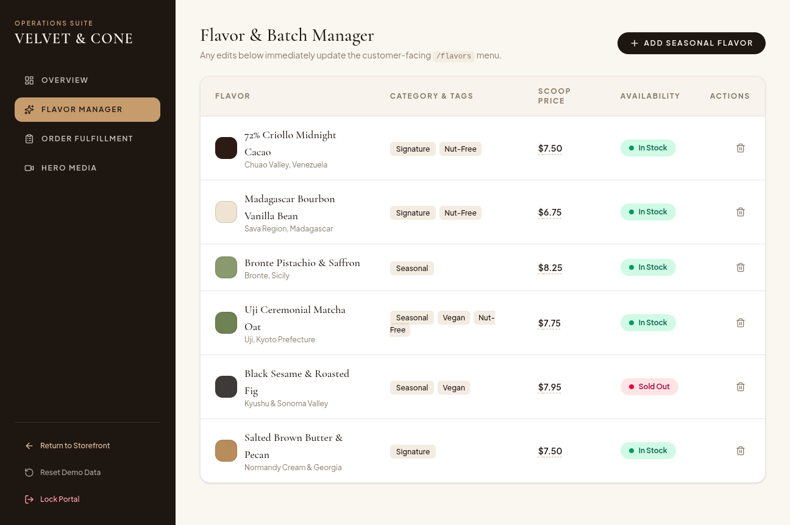
*Figure 17 — Admin — Flavor & Batch Manager. Captured at desktop width (1296 × 862).*

### ADMIN — ORDER FULFILLMENT BOARD

Orders move through four columns — Received, Churning, Ready for Pickup and Completed. Each card shows the customer, boutique, window, itemized scoops and total, with an arrow action that advances the order to the next status.

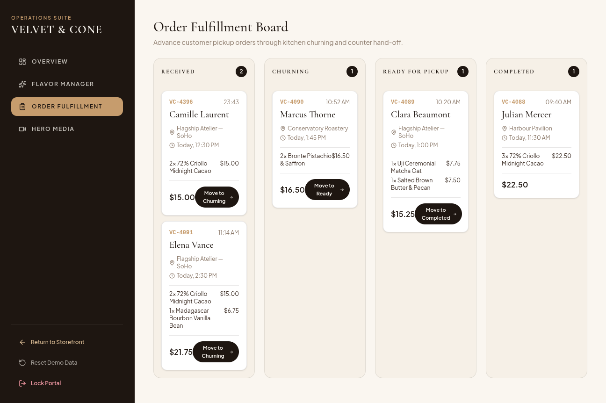
*Figure 18 — Admin — Order Fulfillment Board. Captured at desktop width (1296 × 862).*

### ADMIN — HERO MEDIA MANAGER

The final view controls the homepage canvas: upload a local MP4/WebM to scrub on scroll, choose one of three procedural palettes, or edit the hero headline and tagline. Swatches mirror the three procedural glows used in the 3D hero.

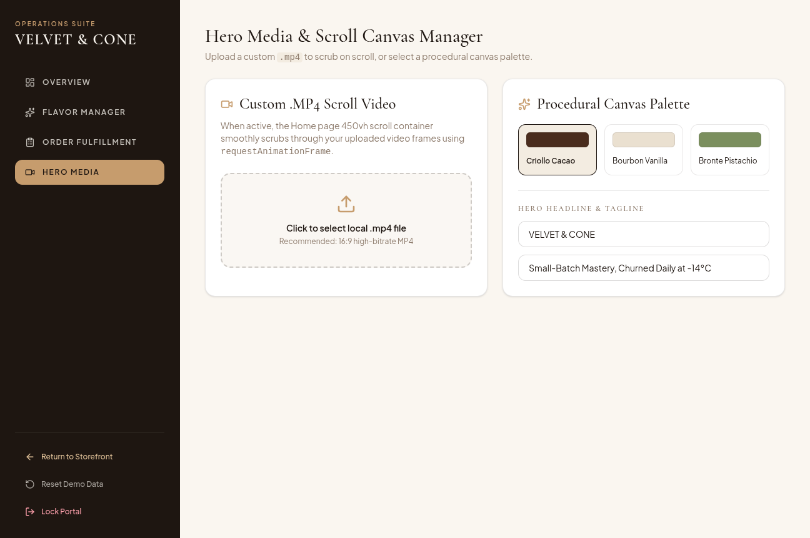
*Figure 19 — Admin — Hero Media Manager. Captured at desktop width (1296 × 862).*

### ADMIN PORTAL NOTES

- Portal navigation is tab-based rather than routed: all four views share the single `/admin` URL and the same sidebar shell.
- The PIN is checked in the browser (`2026`, `1984` or `DEMO`) and the session flag is stored in `sessionStorage`; this is a prototype convenience, not authentication.
- "Reset Demo Data" restores the six seed flavors, four seed orders and the default hero copy. The uploaded video URL is kept in memory only and is released when replaced or reset.
- The portal deliberately shares the storefront's colors, type and radiuses, but trades editorial spacing for white tables, compact labels and 12px metadata to support daily operations.

---

*Velvet & Cone · Design Documentation · November 2026*  
*Prepared from the front-end prototype in `src/`; all screenshots captured at desktop width from the running Vite dev server.*
